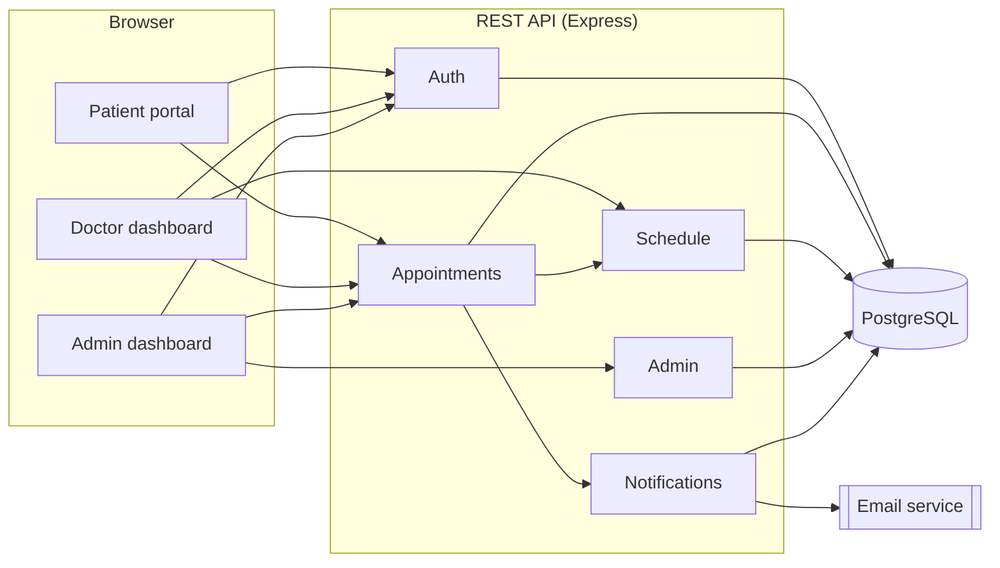

# System architecture (OHAMS-11)

## Style

Three-tier client–server web application talking over a REST API.

| Layer | Technology | Responsibility |
|---|---|---|
| Presentation | React single-page app (static demo in `frontend/`) | Patient portal, doctor dashboard, admin dashboard |
| Application | Node.js + Express REST API (Vercel serverless functions) | Business rules, validation, authentication |
| Data | PostgreSQL (managed) | Persistent storage – see [database.md](database.md) |
| External | Email service (Nodemailer / SendGrid) | Confirmation, cancellation and reminder emails |

**Why this style:** three clear layers let the team split work (frontend / backend / database), every layer can be hosted on free tiers, and a relational database fits appointment data, which needs strict rules such as no double booking.

## Component diagram

