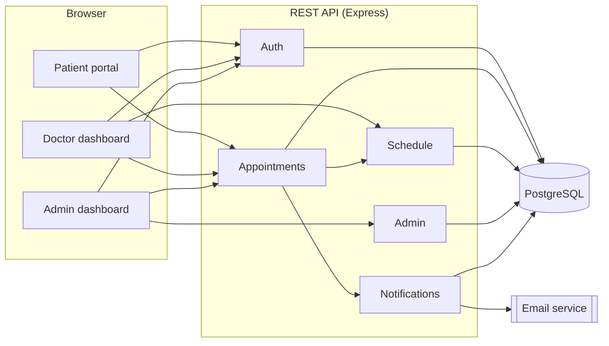

# System architecture (OHAMS-11)

## Style

Three-tier client–server web application talking over a REST API.

| Layer | Technology | Responsibility |
|---|---|---|
| Presentation | React single-page app (static demo in `frontend/`) | Patient portal, doctor dashboard, admin dashboard |
| Application | Node.js + Express REST API (Vercel serverless functions) | Business rules, validation, authentication |
| Data | PostgreSQL (managed) | Persistent storage – see [database.md](database.md) |
| External | Email service (Nodemailer / SendGrid) | Confirmation, cancellation and reminder emails |

**Why this style:** three clear layers let the team split work (frontend / backend / database), every layer can be hosted on free tiers, and a relational database fits appointment data, which needs strict rules such as no double booking.

## Component diagram

## REST API

| Method | Endpoint | Allowed role |
|---|---|---|
| POST | `/api/auth/register` | Public |
| POST | `/api/auth/login` | Public |
| GET | `/api/departments` | Any logged-in user |
| GET | `/api/doctors?department=` | Patient |
| GET | `/api/doctors/:id/slots?date=` | Patient |
| POST | `/api/appointments` | Patient |
| GET | `/api/appointments/me` | Patient |
| PATCH | `/api/appointments/:id/cancel` | Patient, Doctor, Admin |
| PATCH | `/api/appointments/:id/reschedule` | Patient |
| GET | `/api/doctors/me/appointments?from=&to=` | Doctor |
| PATCH | `/api/appointments/:id/status` | Doctor |
| GET / PUT | `/api/doctors/me/availability` | Doctor |
| GET | `/api/admin/appointments` | Admin |
| GET | `/api/admin/stats` | Admin |
| POST / PUT | `/api/admin/doctors` | Admin |
| POST / PUT | `/api/admin/departments` | Admin |

Errors use standard status codes: `400` invalid input, `401` not logged in, `403` wrong role, `404` not found, `409` slot already taken.
