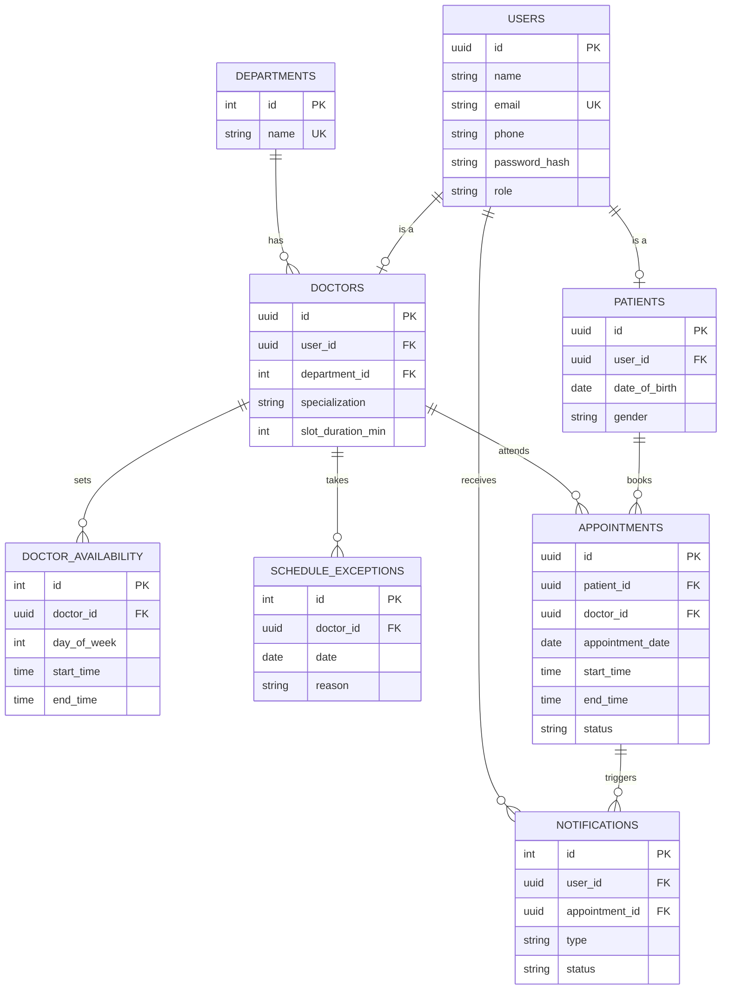

# Database design (OHAMS-10)

## Entities

| Entity | Purpose |
|---|---|
| User | Login account for every role (patient, doctor, admin) |
| Patient | Patient profile, one per patient user |
| Department | Hospital department, e.g. Cardiology |
| Doctor | Doctor profile, belongs to one department |
| DoctorAvailability | Weekly working hours of a doctor |
| ScheduleException | Days a doctor is on leave |
| Appointment | A booked slot between a patient and a doctor |
| Notification | Message sent to a user about an appointment |

## Relationships

- User 1–1 Patient, User 1–1 Doctor (admins have no profile)
- Department 1–N Doctor
- Doctor 1–N DoctorAvailability, Doctor 1–N ScheduleException
- Patient 1–N Appointment, Doctor 1–N Appointment
- Appointment 1–N Notification

## ER diagram

## Tables and constraints

Full SQL: [`schema.sql`](schema.sql) (tested on PostgreSQL 16).

Key rules:

- **No double booking** – partial unique index on `appointments(doctor_id, appointment_date, start_time) WHERE status <> 'cancelled'`. A cancelled slot can be booked again; a second active booking of the same slot is rejected by the database.
- `CHECK (end_time > start_time)` on appointments and availability
- Roles, appointment status and notification type are limited with `CHECK` constraints
- Appointment history is protected with `ON DELETE RESTRICT`
- Indexes on `appointments(patient_id)` and `appointments(doctor_id, appointment_date)` for dashboard queries
- Only bcrypt password hashes are stored, never plain passwords

## Normalisation (3NF)

- Every table has a single-column primary key and atomic columns (1NF)
- No partial dependencies, since keys are single-column (2NF)
- Department name lives only in `departments`; doctor profile data lives only in `doctors`, login data only in `users` – no non-key column depends on another non-key column (3NF)
- Slot end time is stored with the appointment on purpose, so a later change to a doctor's slot length does not rewrite past appointments

Reviewed with the backend owner (OHAMS-3) so API models match these tables.
