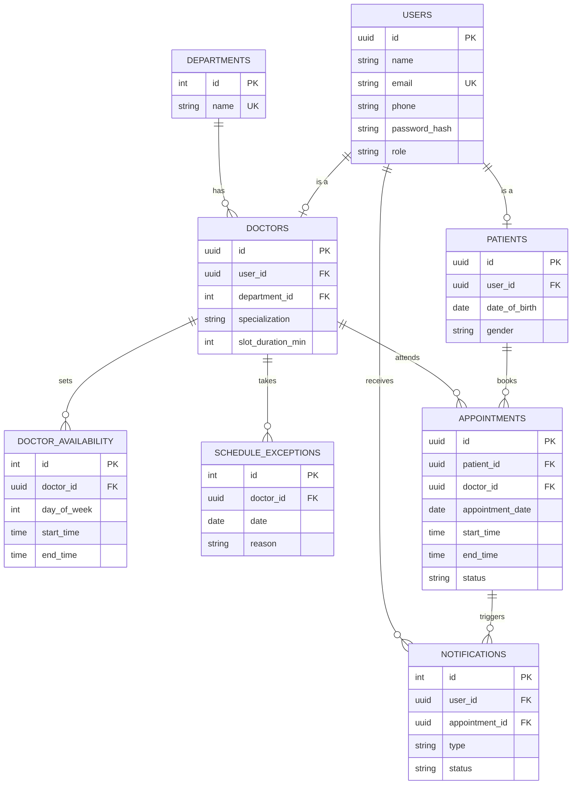

# Database design (OHAMS-10)

## Entities

| Entity | Purpose |
|---|---|
| User | Login account for every role (patient, doctor, admin) |
| Patient | Patient profile, one per patient user |
| Department | Hospital department, e.g. Cardiology |
| Doctor | Doctor profile, belongs to one department |
| DoctorAvailability | Weekly working hours of a doctor |
| ScheduleException | Days a doctor is on leave |
| Appointment | A booked slot between a patient and a doctor |
| Notification | Message sent to a user about an appointment |

## Relationships

- User 1–1 Patient, User 1–1 Doctor (admins have no profile)
- Department 1–N Doctor
- Doctor 1–N DoctorAvailability, Doctor 1–N ScheduleException
- Patient 1–N Appointment, Doctor 1–N Appointment
- Appointment 1–N Notification

## ER diagram

