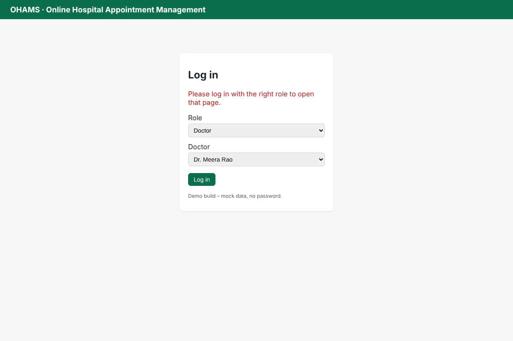
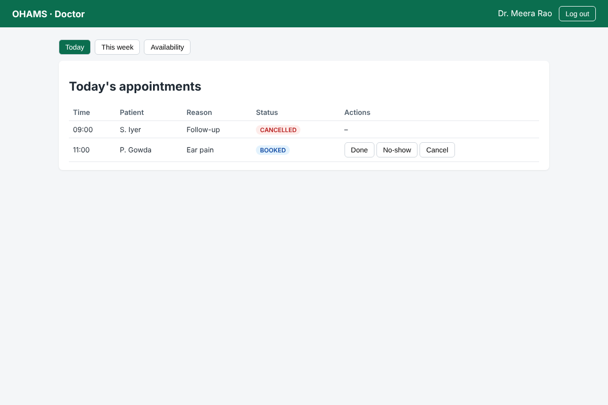
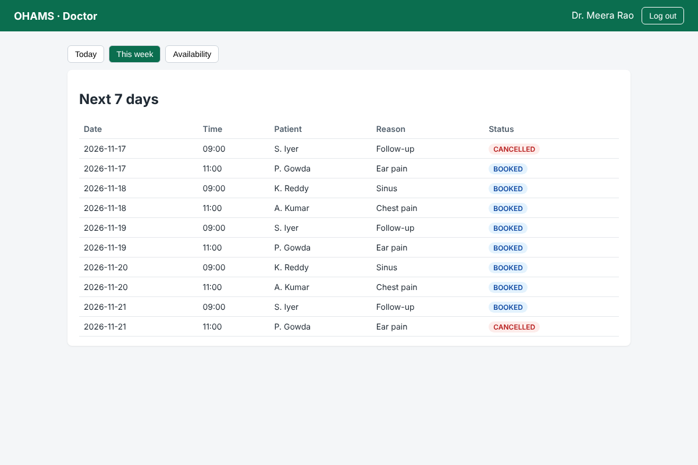
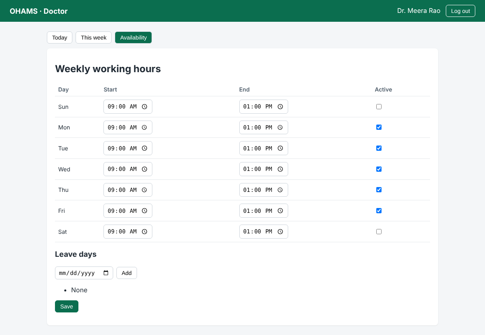
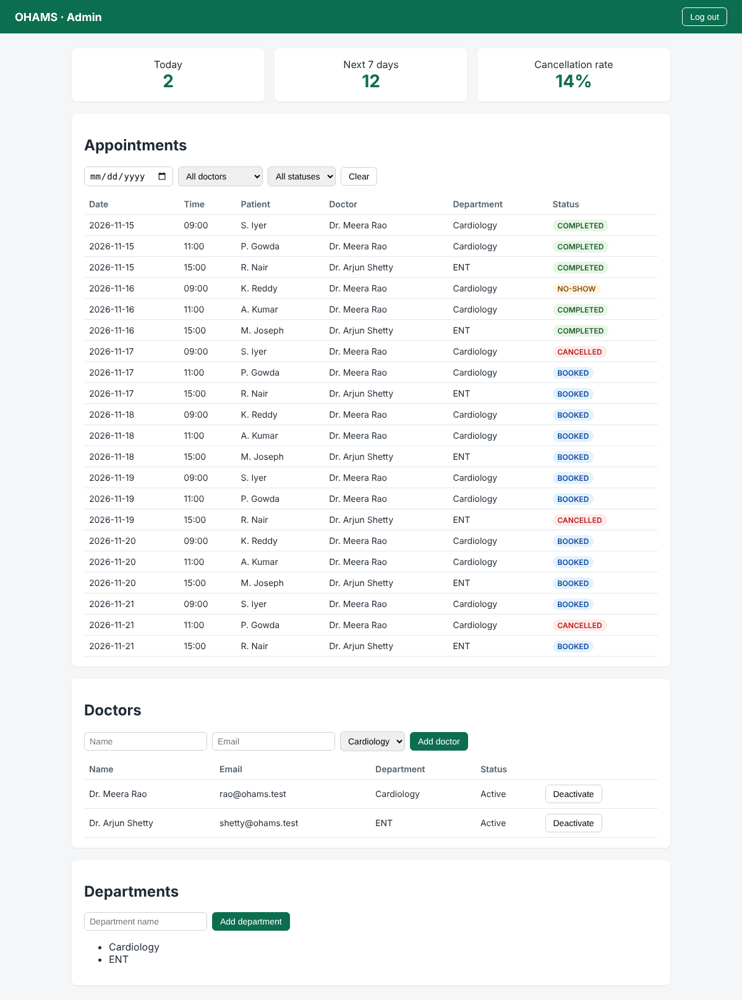

# Dashboard wireframes (OHAMS-18)

Low-fidelity layouts for the doctor and admin dashboards.

## Login / role picker

```
+--------------------------------------+
|  OHAMS                               |
|  Email    [__________________]       |
|  Role     ( ) Doctor  ( ) Admin      |
|           [ Log in ]                 |
+--------------------------------------+
```

## Doctor dashboard

```
+----------------------------------------------------------+
| OHAMS · Doctor          Dr. Rao (Cardiology)   [Log out] |
+----------------------------------------------------------+
| [Today] [This week] [Availability]                       |
|                                                          |
| Today's appointments                                     |
| Time   Patient      Reason          Status   Actions     |
| 09:00  A. Kumar     Chest pain      BOOKED   [Done][No-show][Cancel] |
| 09:15  S. Iyer      Follow-up       BOOKED   [Done][No-show][Cancel] |
+----------------------------------------------------------+
```

## Availability editor

```
| Day   Start   End    Active |
| Mon   09:00   13:00  [x]    |
| Tue   09:00   13:00  [x]    |
| ...                         |
| Leave days: [date] [Add]    |
|           [ Save ]          |
```

## Admin dashboard

```
+----------------------------------------------------------+
| OHAMS · Admin                                  [Log out] |
+----------------------------------------------------------+
| [Today: 12] [This week: 58] [Cancellation rate: 8%]      |
|                                                          |
| Appointments   Filter: [date] [doctor v] [status v]      |
| Date  Time  Patient  Doctor  Dept  Status                |
|                                                          |
| Doctors        [+ Add doctor]                            |
| Departments    [+ Add department]                        |
+----------------------------------------------------------+
```

## Screenshots (demo build)

| Screen | |
|---|---|
| Login / role picker |  |
| Doctor – today |  |
| Doctor – this week |  |
| Doctor – availability |  |
| Admin |  |

Role guard: opening `doctor.html` or `admin.html` without the matching role sends the user back to the login page.
